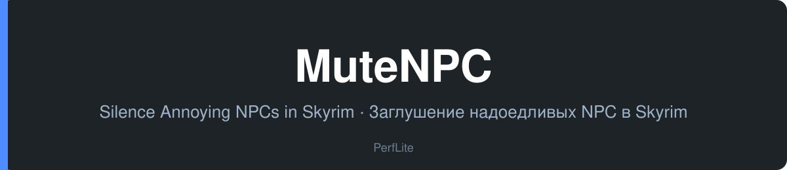

<div align="center">



<p>
  <a href="#english">🇬🇧 English</a> ·
  <a href="#русский">🇷🇺 Русский</a>
</p>

<p>
  
  
  
  
  
</p>

<p>
  <a href="https://github.com/PerfLite/MuteNPC/releases/latest"><b>⬇️ Download / Скачать</b></a> ·
  <a href="https://github.com/PerfLite/MuteNPC/releases">📦 All releases / Все релизы</a>
</p>

</div>

## ⬇️ Download / Скачать

| File / Файл | Description / Описание | Link / Ссылка |
|---|---|---|
| `MuteNPC-v1.0.0.zip` | SKSE plugin for Skyrim SE / AE / VR · SKSE-плагин для Skyrim SE / AE / VR | [Download](https://github.com/PerfLite/MuteNPC/releases/latest/download/MuteNPC-v1.0.0.zip) |

> Older versions and changelogs: [Releases](https://github.com/PerfLite/MuteNPC/releases) ·
> Старые версии и список изменений: [Релизы](https://github.com/PerfLite/MuteNPC/releases)

---

## English

A native C++ SKSE64 plugin powered by [CommonLibSSE-ng](https://github.com/CharmedBaryon/CommonLibSSE-ng) for selectively and completely muting annoying NPCs in Skyrim Special Edition, Anniversary Edition, and Skyrim VR.

### Features

- **Crosshair Target Action**: Aim at any NPC in the world and mute them with a single click in the in-game menu.
- **Complete Silence**: Clears voice audio descriptors across ambient comments, preaching scenes, direct dialogue ('E' key), and goodbyes.
- **Subtitle Suppression**: Toggle to hide floating subtitles for muted dialogue so your screen stays clean.
- **In-Game Settings**: Clean UI integrated with [SKSE Menu Framework](https://www.nexusmods.com/skyrimspecialedition/mods/120352) with convenient *[Remove]* buttons on the left.
- **Multi-Language Support**: Automatic game language detection with a live in-game language selector (*Auto* / *English* / *Русский*) and easy translation via `MuteNPCStrings_<LANG>.json`.
- **Zero Hardcoding**: Fully dynamic JSON config with no hardcoded actor records.

### Install

#### Requirements

- [Skyrim Special Edition](https://store.steampowered.com/app/489830/) (1.5.97) / [Anniversary Edition](https://store.steampowered.com/app/489830/) (1.6.x) / Skyrim VR
- [SKSE64](https://skse.silverlock.org/)
- [Address Library for SKSE Plugins](https://www.nexusmods.com/skyrimspecialedition/mods/32444)
- [SKSE Menu Framework](https://www.nexusmods.com/skyrimspecialedition/mods/120352)

#### Steps

Install `MuteNPC-v1.0.0.zip` using your mod manager (**Mod Organizer 2** or **Vortex**), or clone/extract to your Data directory:

```
https://github.com/PerfLite/MuteNPC
```

### Build

```bash
xmake config -m release
xmake
```

### License

MIT — see [LICENSE](LICENSE).

<p align="right"><a href="#english">↑ Back to top</a> · <a href="#русский">Русский ↓</a></p>

---

## Русский

Нативный SKSE64-плагин на C++ (на базе [CommonLibSSE-ng](https://github.com/CharmedBaryon/CommonLibSSE-ng)) для выборочного и полного заглушения надоедливых NPC в Skyrim Special Edition, Anniversary Edition и Skyrim VR.

### Возможности

- **Заглушение цели под прицелом**: Наведите прицел на любого NPC и заглушите его в один клик через игровое меню.
- **Полная тишина**: Звуковые дорожки обнуляются везде — случайные выкрики, проповеди, личный диалог по «E» и прощания.
- **Скрытие субтитров**: Опция отключения всплывающих субтитров для заглушённых фраз.
- **Удобное меню в игре**: Аккуратный интерфейс через [SKSE Menu Framework](https://www.nexusmods.com/skyrimspecialedition/mods/120352) с удобными кнопками *[Удалить]* слева от имени.
- **Мультиязычность**: Автоопределение языка с переключателем прямо в меню настроек (*Auto* / *English* / *Русский*) и простая поддержка переводов через `MuteNPCStrings_<ЯЗЫК>.json`.
- **Без хардкода**: Динамический список персонажей и чистый JSON-конфиг.

### Установка

#### Требования

- [Skyrim Special Edition](https://store.steampowered.com/app/489830/) (1.5.97) / [Anniversary Edition](https://store.steampowered.com/app/489830/) (1.6.x) / Skyrim VR
- [SKSE64](https://skse.silverlock.org/)
- [Address Library for SKSE Plugins](https://www.nexusmods.com/skyrimspecialedition/mods/32444)
- [SKSE Menu Framework](https://www.nexusmods.com/skyrimspecialedition/mods/120352)

#### Шаги

Установите архив `MuteNPC-v1.0.0.zip` с помощью любого мод-менеджера (**Mod Organizer 2** или **Vortex**):

```
https://github.com/PerfLite/MuteNPC
```

### Сборка

```bash
xmake config -m release
xmake
```

### Лицензия

MIT — см. [LICENSE](LICENSE).

<p align="right"><a href="#русский">↑ Наверх</a> · <a href="#english">English ↑</a></p>
